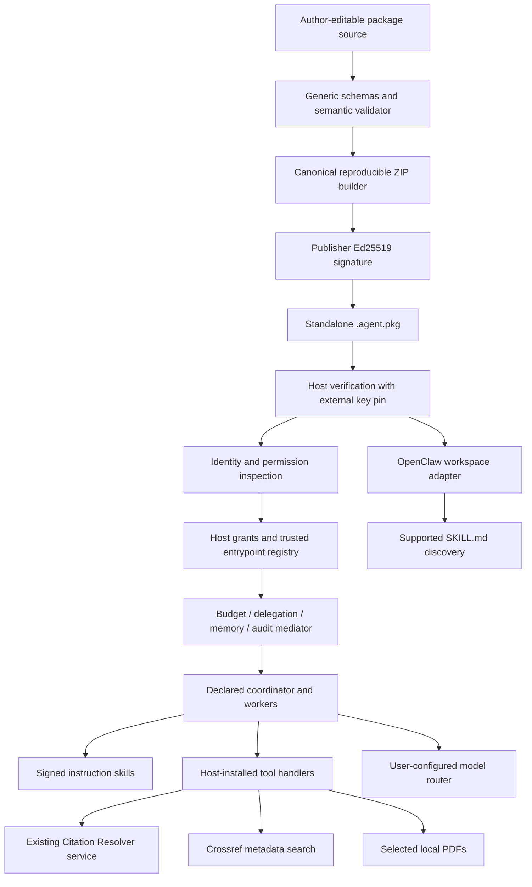

# Architecture and concrete design decisions

Historical milestone-1 document. Current generic execution, reference packages and
verification results are documented in [workflow migration](workflow-migration.md),
[workflow.v0](../spec/workflow-v0.md), and the [new report](workflow-report.md).
The former host-specific execution path is now explicitly retained under `agentpkg.dev`.

The PDF was read in full (31 pages), including the image-only stack on p. 27. Its key principle is retained: downloaded behavior does not confer authority. The format remains generic; the first example is an application of it.

## Decisions that turn the PDF into an implementation

| PDF proposal | Concrete v0 choice and reason |
|---|---|
| Signed JAR-like agent package, pp. 7–10 | Data-only ZIP_STORED with canonical JSON and exact member hashes. No executable payload is necessary to demonstrate portability. |
| `agent.package` terminology, pp. 3, 7–9 | Conceptual name Agent Package v0; distribution `*.agent.pkg`, matching the professor's terminology. No claim of official standardization. |
| HOCON graph source, pp. 9, 26 | Authoritative JSON graph. HOCON compilation may be added later; two sources of truth would be unsafe now. |
| Identity and trust, pp. 5, 20, 23 | Signed asserted package/publisher strings plus externally pinned Ed25519 key. Names and self-reported attestations are not a verified real-world identity. |
| Package signatures, pp. 6–10 | Domain-separated signature over the JCS integrity statement; envelope excluded to avoid self-reference. All payload bytes, including eval fixtures, are covered. |
| Browser authority/permissions, pp. 5, 14 | Explicit host grants intersect declared permissions and role tool lists. No package code or instruction can widen them. |
| Local/private service split, pp. 12–13, 17 | Local coordination/reasoning/data handling; remote resolver and Crossref APIs. API keys remain in host/server configuration. |
| Message box vs endpoints, p. 11 | Local worker tasks receive immutable copied messages and return structured patches. Read-only remote calls use explicit endpoints; no bidirectional remote-agent callbacks. |
| Token economics, p. 15 | Atomic per-worker/global reservation and call counting, host-lowered caps, conservative failure accounting. Monetary estimates are not escrow or a dollar-cap implementation. |
| Model router, p. 16 | Provider-neutral task requirements and an explicit host router contract. Native OpenClaw advisory caps are not presented as hard limits. |
| Memory capsules, p. 18 | Schemas represent all six scopes; runtime implements session/ephemeral views and rejects persistent scopes. Explicit outputs are durable exports, not hidden memory. |
| Governed delegation, p. 19 | Declared roles, depth one, role/global semaphores, independent budgets, audit. Future remote/NANDA roles can be inspected but execution fails closed. |
| NANDA, pp. 20–22 | Stable package IDs and nullable HTTPS/NANDA locators. No resolver, registry, AgentRank or marketplace. |
| Attestations, p. 23 | Self-authored provenance, runtime dependency inventory and external eval receipts. No invented third-party certification. |

## Separation and genericity

`agentpkg` contains format validation, packaging, signing, authority mediation, transport and adapter code. `agents/literature-review` contains only reference package data. Its specialized orchestration lives in the separately installed `literature.review` host entrypoint. Unknown entrypoints remain inspectable/buildable/signable packages, but require an installed trusted interpreter to execute. The independent Meeting Agenda format tests exercise this distinction.

The literature graph has nine stages, nine roles total and seven skills. CitationWorker serves both optional seed discovery and final metadata verification. A role may use multiple skills; stage topology is declarative and the trusted workflow rejects graphs it cannot interpret. `parallel:false` is serial; `parallel:true` uses ordered bounded scheduling and deterministic merging. Workers cannot recursively spawn another worker.

The coordinator owns full research state. Worker inputs are deep copies restricted to declared top-level read fields, and patches may update only declared write fields. Each model call loads only the role's package skills. No model output is executed. Final research state, tool interfaces and model outputs receive schema checks; evidence quotes and citation/claim relationships receive additional semantic invariants.

## Trust and enforcement profile

Enforced now: strict schema/version/reference checks; safe deterministic archive operations; complete payload integrity; pinned publisher verification for live runs/staging; no executable package imports; denied-by-default permissions; role tool restrictions; state views; fixed host binding contracts; direct approved HTTPS with DNS pinning; no redirects/proxies; bounded/killable network and PDF operations; global/per-worker token/call accounting; role/global concurrency and delegation depth; exact resolver status handling; citation/evidence links; removal of unsupported drafted claims; and audit export for successful/failed worker execution.

Conditional: external token ceilings require a truthful, compatible host router that enforces output caps and reports all billable tokens. A dishonest provider cannot be retroactively prevented from overspending; known violations are recorded and stop further calls. Semantic entailment is a labelled model judgment, not proof. Source evidence itself may be inaccurate.

Represented but not executed: persistent memory scopes, remote/NANDA worker locators, pinned dependencies, future agent tools, shell/payment permission categories. Tier/latency/cost preferences, estimated dollars, publisher identity strings and attestation content are declarations, not guarantees.

Delivered since: a budget-aware OpenClaw router plugin — an [Agent Browser](openclaw-agent-browser.md) that opens, verifies and authorizes a package, a [run plan](model-selection-and-run-plan.md) that freezes an explicitly chosen host model, a [`ModelRouter` bridge](model-router-bridge.md) that reaches that exact model with a provable input bound and real usage, [package execution](package-execution.md) (a signed package's own `workflow.v0` graph running through the generic interpreter on that model, behind a re-verified preflight and a one-time snapshot handoff), the tool half — a generic `ToolHandler` over a host [tool broker](tool-broker.md), with Literature Review executed through it — and, in milestone 3C, the page's [Run surface](openclaw-agent-browser.md#5a-the-run-surface): a schema-generated task form, a precisely gated Run, live progress, cancellation, reconnect, safe result rendering, verified artifact downloads and the technical audit ([report](demo-experience-report.md)).

Explicitly future (after the demo): scholarly-search federation behind the same abstract `scholarly-search` capability — Crossref + arXiv + OpenAlex, optionally Semantic Scholar — as host implementations with no package change (Crossref-only coverage is thin for recent AI/arXiv topics); `conversation.v0` / `service.v0` profiles; persistent authorization (*Always*) with a revocable store; per-worker or per-node model routing and provider redundancy; a package update flow; richer evals and attestations; arbitrary safe workflow interpreter, HOCON compiler, encrypted/revocable memory vault, NANDA/AgentRank/discovery and remote locators, Muse / Instinct integration, external trust/revocation/transparency infrastructure, remote-agent protocols, payment/escrow and an independently hardened OS sandbox (Maritime).

## Preserving Citation Resolver

No resolution, matching, provider adapter, bibliographic normalization or BibTeX business logic changed. One narrow pre-existing defect was repaired: the hosted `SKILL.md` renderer now replaces the current public origin as well as the legacy placeholder with its configured/validated origin. The standalone skill retains the Railway URL used successfully by OpenClaw. Its existing 132 tests now pass. No deployment was performed.

## Primary external references

Implementation details were checked against [JSON Schema 2020-12](https://json-schema.org/draft/2020-12), [RFC 8785](https://www.rfc-editor.org/rfc/rfc8785), [Cryptography Ed25519](https://cryptography.io/en/latest/hazmat/primitives/asymmetric/ed25519/), [Crossref REST API](https://www.crossref.org/documentation/retrieve-metadata/rest-api/), and installed/official [OpenClaw skills](https://docs.openclaw.ai/tools/skills). The supplied PDF remains the architecture source; these references supply concrete implementation contracts.
