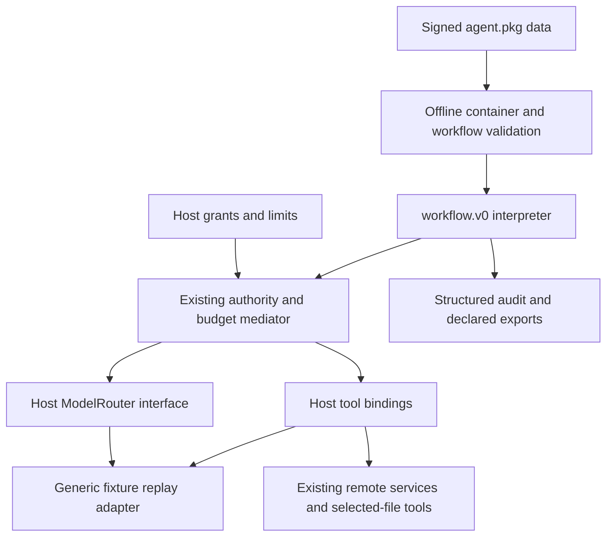

# Migration to generic execution

The current reference packages declare `entrypoint: "workflow.v0"`; their only executable graph is `graph.json`. `agentpkg.workflow.Workflow` runs both without importing an application module. This closes the previous milestone's gap between generic inspection and generic execution.

The supplied 31-page *Portable AI Agents and the OpenClaw Agent-Native Browser* PDF was read, including the graphical stack on page 27. Pages 9–10 and 26–27 separate declarative orchestration from instructions and runtime; pages 12–19 separate services, authority, model routing, memory and delegation. This milestone implements that execution boundary. A future browser can select a host model/router and grants, then execute an unknown compatible graph; it does not need a new Literature Review or Meeting Agenda interpreter. Browser UI and all named downstream integrations remain out of scope.

## Changed architecture



The interpreter owns scheduling, explicit projections, isolation, bounded worker instantiation, dependency checks, joins, state commits, model/tool dispatch, validation, error propagation, deadlines and cancellation. `Runtime` continues owning permission checks, role/global concurrency, atomic token reservations, remote/tool-call accounting and the audit chain. Existing archive/signature code was not replaced; inspection now displays either legacy stages or workflow nodes, and validation routes by execution profile.

Package data owns the graph, task identifiers, skill instructions, application schemas, output mappings, validation relationships, tool declarations and limits. Host tool adapters contain provider protocol handling, not agent orchestration. Generic replay loads cases from each package; it has no task-name or package-name branches and fails on an unknown input instead of silently returning an unrelated canned answer.

## Literature Review

Version 0.2.0 preserves the seven skills, nine roles, selected-PDF tool, remote Citation Resolver contract, session isolation, three-worker cap, 180,000-token cap, 45 remote-call cap, tool-call limits and per-worker 30,000-token/15-remote-call bounds. Original schemas remain, with additional schemas for workflow input, node outputs and explicit intermediate collections.

The canonical sequence is planning → seed discovery → parallel search → join → normalization/deduplication → parallel screening → included-record selection → parallel citation resolution → preparation and record checks → parallel evidence extraction → evidence join → synthesis → writing → verification → output checks → outputs. Optional document reads occur inside the screening/evidence map workers; full source pages are item-local and do not become shared state.

Normalization, screening policy, evidence preparation and writing are now package-instructed model operations. Exact time/data/record checks use the generic validate primitive. In particular, the graph checks resolved metadata against raw resolver responses, DOI identity when supplied, exact source quotations/pages, evidence links, supported-reference status, and final bibliography metadata. Ambiguous, not-found and provider-error **responses** remain data with distinct statuses. A raised tool/transport error fails the new workflow; the old application-specific catch-and-continue orchestration is intentionally not part of workflow.v0.

The fixture is a migrated, explicitly synthetic replay of the established baseline scenario: three searches, eight candidates, six resolution attempts with all four outcomes represented, three bibliography entries, and ten evidence items. Its output does not claim live model reasoning. New questions require a host router or additional authored fixture cases. The generic LLM interface and package skill/schema contract are ready for that next milestone; model quality on arbitrary inputs is not established here.

The schema/assertion checks do not prove that arbitrary generated prose follows from sources or that a model did not omit a relevant candidate. The final prose and entailment judgments remain package-instructed model behavior. The legacy development renderer's scientific behavior remains available separately for regression comparison. A production model integration will need adversarial semantic evaluation in addition to these execution tests.

## What happened to the old code

- The former 1,163-line `agentpkg/literature.py`, including its `STAGES`, `ROLES`, stage-name dispatch, Python closures and bespoke merging, moved to `agentpkg/dev/literature.py` as an explicit **legacy development runner**. It is not imported by generic execution.
- The specialized evaluation harness moved from `agentpkg/literature_evals.py` to `agentpkg/dev/literature_evals.py`.
- The former application-specific CLI is preserved as `agentpkg/dev/legacy_cli.py`, available through `agentpkg-legacy` or `python -m agentpkg.dev.legacy_cli`. The main `agentpkg run` and `eval` commands execute workflow.v0 only.
- `agents/literature-review-legacy` is an unchanged source snapshot. `dist/literature-review-legacy.agent.pkg` preserves the previous signed artifact, still verifiable with `examples/keys/publisher.pub.pem`.
- Existing regression tests that exercise the old application behavior now explicitly target that snapshot/development API. They were not deleted. The future-version rejection test now uses `99.0.0`, because runtime version 0.2.0 is supported.

This is an explicit profile migration, not two competing graphs in one package. The legacy snapshot has its own manifest/source/artifact. New reference packages contain no Python orchestration. Packaging and publisher signatures cover the new graph and fixtures just as they cover every other member.

## Meeting Agenda

`agents/meeting-agenda` is independently authored data: three skills, four roles, no tools or external API requirements. Planning identifies focus items and perspective workers; an ordered bounded map gathers perspectives, join collects them, writing returns an agenda, and validation checks that goal/duration are preserved and allocated minutes sum to the requested duration. Empty maps work without special application code.

Its fixture proposes a 45-minute documentation pilot meeting with Product, Engineering and Support perspectives, time allocations of 5/15/15/10 minutes, preparation items, decisions and open questions. It uses the same LLM, map, state, authority, budget and assertion implementations as Literature Review.

## Regression and genericity evidence

New tests execute both built artifacts through the same class; rename package/node identities and reverse the graph's storage order; exercise multiple ready DAG roots and ordered joins; and run in a fresh subprocess to assert that no `agentpkg.dev` or Literature Review module is imported. They also scan the interpreter/validator/mediator/replay source for application terms.

The suite covers invalid graphs/schemas/paths/writes/roles/tools, cycles, duplicate IDs, unauthorized projections, concurrency/instance/item/delegation limits, model and tool schemas, grants, deadlines including token preflight, cancellation, sibling cleanup, budget reservations, failure reports, hash-chained audit, exact source checks, time totals, deterministic builds, signing, unpack/rebuild, CLI exports and staging both profiles.

The original installed-OpenClaw discovery test timed out at 55 seconds before any changes. It is now explicitly opt-in (`AGENTPKG_TEST_OPENCLAW=1`) because a locally installed application's startup is environment-dependent and does not belong in the deterministic default suite. All staging tests still run by default. No OpenClaw configuration or application implementation was modified.

## Commands

From the repository root:

```sh
agentpkg/.venv/bin/python -m pip install --no-deps --no-build-isolation -e ./agentpkg
agentpkg/.venv/bin/python -m pytest agentpkg/tests
agentpkg/.venv/bin/python -m ruff check agentpkg
agentpkg/.venv/bin/python -m ruff format --check agentpkg
(cd citation-resolver && .venv/bin/python -m pytest)
agentpkg/.venv/bin/python scripts/verify_workflow.py
```

Both demos use new output directories:

```sh
agentpkg/.venv/bin/agentpkg run dist/literature-review.agent.pkg \
  --mode fixture --input examples/literature-review-input.json \
  --grants examples/literature-review-grants.json \
  --approve-tool scholarly-search --approve-tool citation-resolver --approve-tool paper-reader \
  --trust-key examples/keys/literature-review-publisher.pub.pem --out examples/my-workflow-review
agentpkg/.venv/bin/agentpkg run dist/meeting-agenda.agent.pkg \
  --mode fixture --input examples/meeting-agenda-input.json \
  --grants examples/meeting-agenda-grants.json \
  --trust-key examples/keys/meeting-agenda-publisher.pub.pem --out examples/my-workflow-agenda
```

Each current artifact is signed by its own key (see [the artifact index](../dist/README.md));
`examples/keys/workflow-publisher.pub.pem` signs only the preserved 0.2.0 artifacts.

Each output has `result.json`, `audit.json`, `usage.json`, `provenance.json`, plus package-declared exports. `provenance.interpreter` and `workflow.started.profile` identify the same execution engine. `agentpkg eval PACKAGE` replays the declared fixture under explicit test grants; it is an execution/constraint smoke evaluation, not the previous application-specific semantic harness.

To reproduce the old fixture or live-provider baseline, use its explicitly named development command and artifact:

```sh
agentpkg/.venv/bin/python -m agentpkg.dev.legacy_cli run \
  dist/literature-review-legacy.agent.pkg --mode fixture \
  --question 'Dynamic agent selection and topology adaptation in multi-agent LLM systems' \
  --grants examples/fixture-grants.json --out examples/my-legacy-review
agentpkg/.venv/bin/python -m agentpkg.dev.legacy_cli eval \
  dist/literature-review-legacy.agent.pkg
```

The existing live-provider instructions remain in `examples/README.md` as historical reproduction instructions; substitute the legacy artifact/command. Live network services were not required for this milestone's default tests. No real model or new provider integration is claimed.
